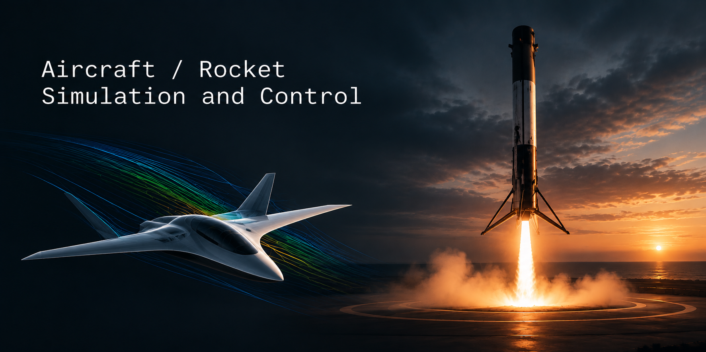

<p align="center">
  
</p>

<h1 align="center">boosted-gnc</h1>

<p align="center">
  Guidance, navigation and control simulation for rockets and aircraft.
</p>

---

**boosted-gnc** plans, flies and visualizes powered-descent trajectories. It pairs convex-optimization guidance
with closed-loop control against a truth model that includes drag, wind and model error, then replays every run
in an interactive 3D viewer.

## Features

- **High-fidelity 6-DOF vehicle simulation** with aerodynamics, wind and thrust vector control
- **Convex optimization trajectory planning** using G-FOLD and SCvx
- **Model predictive control** for closed-loop trajectory tracking
- **3D browser visualization** for replaying and comparing flights

## Quick start

Requires Python 3.13+, [uv](https://docs.astral.sh/uv/) and a Rust toolchain with `cargo` on `PATH`. `uv sync`
builds the Rust sim engine in `sim/` (see [sim/README.md](sim/README.md)) and rebuilds it when its sources change.

```bash
uv sync
uv run python run.py --serve     # open the viewer at http://127.0.0.1:8000
```

From the viewer, **Run selected** or **Run all** re-solves and re-simulates in the background and reloads with the
new results.

### Command line

```bash
uv run python run.py                          # solve and simulate every case
uv run python run.py --only "CASE NAME"       # re-run a single case
uv run python run.py path/to/scenario.json    # use a different scenario
uv run pytest                                 # run the test suite
```

Results are written to `web/data/results.json`, and each run's truth telemetry to
`artifacts/<scenario>/<case>.telemetry.json` (`--artifacts ''` to skip).

## Configuration

Vehicles and scenarios are plain JSON.

| Path | Contents |
|---|---|
| `configs/rockets/` | Mass, Isp, max thrust, throttle limits, gimbal limits, reference area, C_D, geometry |
| `configs/scenarios/` | Initial state, environment, constraints, solver settings, and the list of sim cases |

Each sim case chooses a guidance law, a controller and the truth conditions it flies against:

```json
{
  "name": "SCvx · gusty wind · re-plan 2 Hz · MPC",
  "plan": "scvx",
  "controller": "mpc",
  "replan_hz": 2.0,
  "truth": {
    "drag": true,
    "cd_scale": 1.2,
    "isp_scale": 0.99,
    "wind": {"mean": [0, 0, 8], "shear": 0.14, "gust_sigma": 1.5, "gust_length": 200, "seed": 1}
  }
}
```

| Field | Options |
|---|---|
| `plan` | `gfold`, `scvx` |
| `controller` | `cascade`, `mpc` |
| `replan_hz` | Re-planning rate in flight (omit for a fixed plan) |
| `truth.wind` | Constant vector `[up, x, y]` in m/s, or a shear + gust model |

Guidance never sees the truth model; it plans with the scenario's nominal environment.

### Attitude constraints

Optional keys in a scenario's `constraints` block:

| Key | Effect |
|---|---|
| `constrain_initial_attitude` | Initial thrust direction matches the current body axis |
| `terminal_cone_deg`, `terminal_frac` | Keeps the final part of the burn near vertical |
| `max_slew_deg_s` | Rate limit on the planned thrust direction |

## License

Released under the [MIT License](LICENSE).
